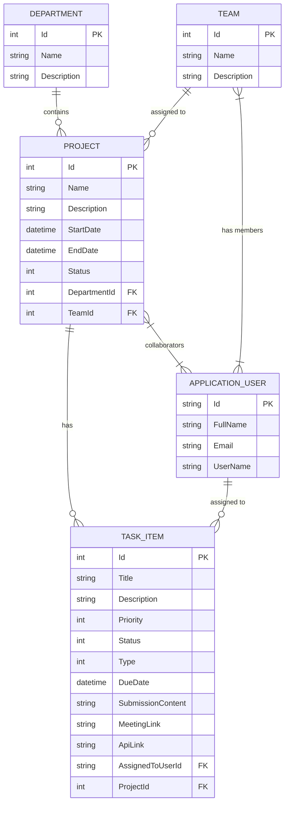

<div align="center">

# ⚡ NEXUS — Enterprise Task & Project Management System

[](https://dotnet.microsoft.com/)
[](https://learn.microsoft.com/aspnet/core/)
[](https://learn.microsoft.com/ef/core/)
[](https://www.microsoft.com/sql-server/)
[](https://getbootstrap.com/)
[](#)

**A high-performance, modern, and intuitive enterprise platform designed to coordinate departments, teams, projects, and task lifecycles with real-time analytics and task deliverables submission.**

نظام إدارة المهام والمشاريع المتقدم للشركات وفرق العمل، مبني بأحدث تقنيات دوت نت وعمارة برمجية احترافية مع واجهة مستخدم مظلمة مستوحاة من التصميم الزجاجي الحديث (Glassmorphism).

[Explore Features](#-key-features) • [Tech Stack](#-technology-stack) • [Architecture](#-project-architecture) • [Getting Started](#-getting-started) • [Database Schema](#-entity-relationship-model)

---

</div>

## 🌟 Overview | نظرة عامة

**NEXUS** is an end-to-end management solution developed to streamline workplace productivity. It empowers organizations to organize departments, assemble agile teams, track project progress across dynamic states, and assign tasks with distinct workflows (code submissions, documentation, bug fixes, meetings, and asset uploads).

Built on **ASP.NET Core 10 MVC**, **Entity Framework Core**, and **ASP.NET Core Identity**, NEXUS features role-based access control (RBAC), interactive KPI dashboards, deliverable management, and automated database seeding for rapid deployment.

---

## 🚀 Key Features | أبرز المميزات

### 1. 🛡️ Role-Based Authentication & Authorization (إدارة الصلاحيات والمستخدمين)
- Built with **ASP.NET Core Identity** for secure user management.
- Multi-tier role permissions (**Admin** vs. **User**):
  - **Admin**: Full authority to create departments, launch projects, assemble teams, assign tasks across users, inspect all submissions, and view system-wide intelligence.
  - **User**: Dedicated workspace focusing on personal assigned tasks, status updates, deliverable submissions, and team collaboration.
- Automatic database role and administrator seeding on first startup (`admin@nexus.com` / `Admin@123`).

### 2. 🏢 Department Management (إدارة الأقسام)
- Structure enterprise divisions (e.g., Engineering, Marketing, Design, QA).
- Track departmental project distributions and resource allocations.

### 3. 👥 Team & Cross-Functional Collaboration (إدارة الفرق)
- Create specialized teams and dynamically assign employees/users.
- Associate teams directly with active projects to simplify organizational workflows.

### 4. 📁 Project Lifecycle Tracking (إدارة المشاريع)
- Comprehensive project lifecycle tracking with status states:
  - `Active`, `Pending`, `Completed`, `OnHold`.
- Start and end date scheduling, department assignment, and team allocations.
- Manage user access at the project level (`ManageUsers`).

### 5. 📋 Advanced Task Workflow & Deliverables (إدارة المهام والتسليمات)
- **Granular Task Categorization**:
  - `CodeSubmission` (with git repo/branch or file delivery)
  - `BugFixing`
  - `Documentation`
  - `Testing`
  - `Review`
  - `Meeting` (with automated meeting URL support)
  - `UploadFile` / `UploadPhoto` (direct attachment upload)
- **Task Priorities**: `Low`, `Medium`, `High`, `Urgent`.
- **Status Pipeline**: `Pending` ➔ `InProgress` ➔ `Completed` / `Cancelled`.
- **Actionable Execution**:
  - **Start Task**: Transition tasks into active progress with one click.
  - **Submit Task**: Upload project deliverables, attach links (meeting links, PRs, API endpoints), or submit written reports.
  - **Submitted Tasks Review**: Dedicated dashboard for leaders to inspect deliverables.

### 6. 📊 Real-Time Analytics & Reporting Dashboard (لوحة التقارير والمؤشرات)
- Interactive productivity index calculated dynamically:
  $$\text{Productivity} = \left(\frac{\text{Completed Tasks}}{\text{Total Tasks}}\right) \times 100$$
- Visual summary widgets: Active Projects, Total Departments, Task Distribution (Pending vs. In Progress vs. Completed).
- Filterable reporting module with one-click **CSV data export**.

### 7. 🎨 Cyberpunk Glassmorphism UI (واجهة حديثة)
- Custom dark cyber-inspired aesthetic (`nexus-theme.css`) with glowing cyan & violet accents.
- Responsive layout across desktop, tablet, and mobile with Bootstrap 5.

---

## 🛠️ Technology Stack | التقنيات المستخدمة

| Layer | Technology | Description |
| :--- | :--- | :--- |
| **Framework** | .NET 10 (C#) | Latest Long-Term Support/Current runtime |
| **Web Layer** | ASP.NET Core MVC | Model-View-Controller pattern with Razor Views |
| **Database ORM** | Entity Framework Core 10 | Code-First migrations, relational mappings |
| **Database** | Microsoft SQL Server | Relational storage for business & identity data |
| **Authentication** | ASP.NET Core Identity | Cookie-based auth with cryptographic hashing |
| **Frontend Styling**| Bootstrap 5, Custom CSS | Cyber/Glassmorphism theme (`nexus-theme.css`) |
| **Client Scripts** | jQuery, Validation Scripts | Unobtrusive client-side validation & AJAX handling |

---

## 📐 Project Architecture | هيكل المشروع

```text
NEXUS/
│
├── NEXUS/                          # Main Application Project
│   ├── Controllers/                # MVC Controllers (Account, Projects, Tasks, Teams, Departments, Reports, Home)
│   ├── Data/                       # AppDbContext & DbInitializer (Data Seeder)
│   ├── Migrations/                 # EF Core Code-First Migrations
│   ├── Models/                     # Core Domain Entities (Project, TaskItem, Team, Department, ApplicationUser)
│   ├── ViewModels/                 # Presentation ViewModels (Dashboard, CreateTask, Reports, etc.)
│   ├── Views/                      # Razor Views organized by Controller
│   ├── wwwroot/                    # Static Assets (custom CSS, JS, Bootstrap, uploads)
│   │   ├── css/nexus-theme.css     # Futuristic Glassmorphism Styling
│   │   └── uploads/                # User task deliverables & attachments
│   ├── appsettings.json            # Configuration & Database Connection Strings
│   ├── Program.cs                  # Pipeline configuration, DI container & middleware
│   └── NEXUS.csproj                # Project dependencies and SDK definitions
│
├── NEXUS.slnx                      # Solution file
├── .gitignore                      # Clean repository ignore configuration
└── README.md                       # Project documentation
```

---

## 🗄️ Entity Relationship Model | العلاقات وقاعدة البيانات



---

## 🏁 Getting Started | خطوات التشغيل والتثبيت

Follow these steps to run NEXUS on your local environment:

### 1. Prerequisites (المتطلبات)
- [.NET 10 SDK](https://dotnet.microsoft.com/download) installed.
- [Microsoft SQL Server](https://www.microsoft.com/sql-server/) (or LocalDB / SQL Server Express).
- [Visual Studio 2022+ / VS Code](https://code.visualstudio.com/) with C# Dev Kit.

### 2. Clone the Repository (استنساخ المستودع)
```bash
git clone https://github.com/Omarabdeltawabahmed/NEXUS.git
cd NEXUS
```

### 3. Configure Database Connection (إعداد الاتصال بقاعدة البيانات)
Open `NEXUS/appsettings.json` and ensure the connection string matches your local SQL Server instance:
```json
{
  "ConnectionStrings": {
    "MyCon": "Server=(local);Database=NEXUS_DB;Integrated Security=True;TrustServerCertificate=True"
  }
}
```

### 4. Apply Database Migrations (إنشاء قاعدة البيانات والجداول)
Run the following command from the project directory:
```bash
dotnet ef database update --project NEXUS
```
*(Or use Visual Studio's Package Manager Console: `Update-Database`)*

### 5. Run the Application (تشغيل المشروع)
```bash
dotnet run --project NEXUS
```
The application will launch and be accessible at:
- `https://localhost:7000` or `http://localhost:5000`

---

## 🔑 Default Credentials | بيانات الدخول الافتراضية

On initial startup, the database initializer automatically seeds the default Administrator account:

| Role | Email | Password |
| :--- | :--- | :--- |
| **System Admin** | `admin@nexus.com` | `Admin@123` |

> *Tip: You can register new users through the registration page (`/Account/Register`), and the Admin can assign them tasks and roles.*

---

## 🗺️ Roadmap & Future Enhancements | التطويرات المستقبلية

- [ ] **Interactive Kanban Board**: Drag-and-drop task movement between Pending, In Progress, and Completed.
- [ ] **Real-time Notifications**: Instant updates via SignalR when tasks are assigned or submitted.
- [ ] **Gantt Chart Timeline**: Visual project milestone schedule.
- [ ] **RESTful Web API**: Endpoints for mobile application connectivity.
- [ ] **Automated Email Alerts**: Background email dispatch for upcoming task deadlines.

---

## 👨‍💻 Author | صاحب المشروع

Developed with ❤️ by **Omar Abdeltawab**  
- **GitHub**: [@Omarabdeltawabahmed](https://github.com/Omarabdeltawabahmed)  
- **Email**: [omarabdeltawab100@gmail.com](mailto:omarabdeltawab100@gmail.com)

---

## 📄 License

This project is open-source and available under the [MIT License](LICENSE).
